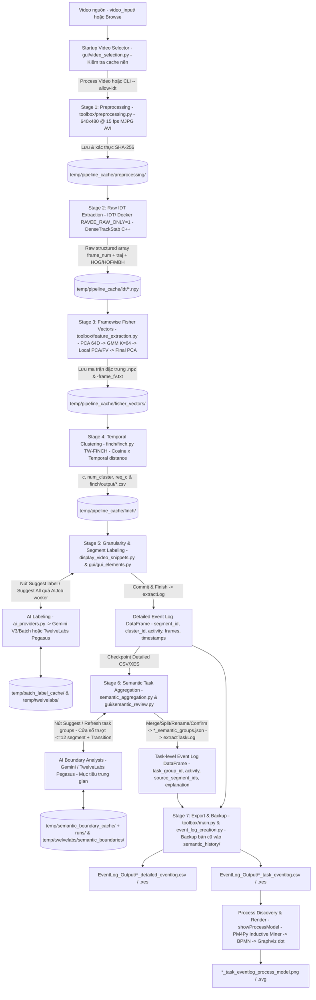

# PROJECT_CONTEXT — RAVEE

> Tài liệu ngữ cảnh tổng thể dự án **RAVEE** (quét từ mã nguồn và tài liệu thực tế trong repository).

## 1. Tổng quan dự án

**RAVEE** là ứng dụng desktop + pipeline xử lý video nhằm chuyển đổi video quy trình công việc thành:
1. Các phân đoạn hành động theo thời gian (**FINCH segments**),
2. Nhãn hoạt động nguyên tử được con người xác nhận (**Detailed Event Log** — CSV/XES),
3. Các nhóm tác vụ có ý nghĩa theo mục tiêu trung gian (**Task-level Event Log** — CSV/XES),
4. Mô hình quy trình **BPMN** (xuất trực tiếp ra ảnh PNG/SVG phục vụ Process Mining).

Phiên bản fork hiện tại mở rộng RAVEE gốc với:
- **Pipeline non-demo có cache xác thực theo từng chặng** (`preprocessing` → `IDT` → `fisher_vectors` → `finch`) kèm màn hình chọn video khởi động (**Select Video to Process**).
- **Gợi ý nhãn AI đa phương thức** với hai chế độ: đơn lẻ có ngữ cảnh trước/sau (**Label Suggester V3**) và hàng loạt toàn video trong 1 request (**Suggest All**).
- **Tổng hợp tác vụ ngữ nghĩa (Semantic Task Aggregation)** có giao diện duyệt thủ công (Merge/Split/Rename/Undo/Confirm) và phân tích ranh giới theo mục tiêu trung gian bằng AI.
- **Đa nhà cung cấp AI độc lập theo chặng**: **Google Gemini** (mặc định) và **TwelveLabs Pegasus** (tùy chọn).
- **Quản lý vòng đời GUI an toàn luồng (Tkinter main-thread ownership)**, khôi phục hạn mức (Quota Recovery) không chặn giao diện, và bộ kiểm thử hồi quy hoàn toàn offline.

---

## 2. Cây thư mục

```text
RAVEE/
├── toolbox/                                  # Lõi pipeline, điều phối, cache, tổng hợp ngữ nghĩa & xuất log
│   ├── main.py                               # Điểm vào chính (GUI selector / CLI / Demo mode)
│   ├── preprocessing.py                      # Giảm kích thước & FPS video (640x480 @ 15 fps, MJPG AVI)
│   ├── file_video_stream.py                  # Đọc frame đa luồng cho preprocessing
│   ├── pipeline_cache.py                     # Hệ thống cache atomic có fingerprint, Docker IDT runner & validators
│   ├── feature_extraction.py                 # Tính Framewise Fisher Vector (Global PCA → GMM → Local PCA/FV → Final PCA)
│   ├── fv_profiling.py                       # Profiling thời gian chạy in-memory cho bước Fisher Vector
│   ├── display_video_snippets.py             # Chuyển kết quả FINCH thành danh sách segment liền kề và mở GUI gán nhãn
│   ├── semantic_aggregation.py               # Logic phân nhóm task ngữ nghĩa, gọi AI boundary, validator, CLI standalone
│   ├── event_log_creation.py                 # Tạo/đọc/xuất Detailed & Task CSV/XES (PM4Py) và render BPMN (Graphviz dot)
│   ├── custom_exceptions.py                  # Các ngoại lệ tùy biến của pipeline
│   ├── NON_DEMO_PIPELINE.md                  # Tài liệu chi tiết pipeline non-demo, cache và Docker IDT
│   ├── PROCESS_MODEL_AND_LABELS_V3.md        # Tài liệu xuất BPMN headless, Label Suggester V3 & Gemini Hydrogen
│   └── SEMANTIC_AGGREGATION.md               # Tài liệu thiết kế, độ tin cậy API và review Semantic Task Aggregation
│
├── gui/                                      # Giao diện desktop Tkinter/ttk và quản lý vòng đời UI
│   ├── lifecycle.py                          # Quản lý 1 hidden Tk root duy nhất, AfterCallbacks, WorkerInbox, AIJob, DecisionChannel
│   ├── theme.py                              # Hệ thống theme ttk dùng chung, header & căn chỉnh cửa sổ
│   ├── video_preview.py                      # Tính toán kích thước & scale frame giữ nguyên tỷ lệ (có hỗ trợ upscale)
│   ├── video_selection.py                    # Cửa sổ khởi động chọn video, kiểm tra cache nền & chạy worker chuẩn bị pipeline
│   ├── gui_elements.py                       # Cửa sổ chọn độ mịn cụm (granularity) và Segment Activity Labeling (V3 + Suggest All)
│   ├── semantic_review.py                    # Cửa sổ duyệt Semantic Task Aggregation (PanedWindow, preview, Merge/Split/Undo)
│   ├── quota_recovery.py                     # Hộp thoại nonmodal khôi phục khi cạn daily quota (RPD)
│   ├── ai_upload.py                          # Hộp thoại xin xác nhận người dùng khi upload file lớn (>64 MiB) lên TwelveLabs
│   └── gui_elements.py.bak                   # Bản sao lưu lịch sử
│
├── finch/                                    # Thuật toán phân cụm phân cấp theo thời gian (TW-FINCH)
│   ├── finch.py                              # Cài đặt FINCH / TW-FINCH (cosine + temporal distance, tùy chọn PyNNDescent)
│   ├── input/                                # Thư mục lưu đầu vào Fisher Vector dạng text (-frame_fv.txt)
│   └── output/                               # Thư mục lưu kết quả phân cụm (*-c.csv, *-num_cluster.csv)
│
├── IDT/                                      # Git submodule riêng (Improved Dense Trajectories + Docker wrapper; có patch local)
│   ├── Dockerfile                            # Ubuntu 20.04 + OpenCV 3.4.12 + pandas 1.5.3 + numpy 1.21 + densetrack C++ ext
│   ├── .dockerignore                         # Loại bỏ data/, features/ khi build image (file untracked quan trọng)
│   ├── run_idt.py                            # Entrypoint trong container; hỗ trợ RAVEE_RAW_ONLY=1 xuất raw trajectory .npy
│   ├── setup.py                              # Build C++ extension `densetrack`
│   ├── src/                                  # Mã nguồn C++ DenseTrackStab (DenseTrackStab.cpp/.h, Descriptors.h, OpticalFlow.h, ...)
│   ├── data/                                 # Video đầu vào mẫu/cũ (person01_boxing_d1_uncomp.avi, 1_3197334-..._reduced.avi)
│   └── features/                             # CSV descriptor tổng hợp mức video (hog/hof/mbh_features.csv)
│
├── ai_providers.py                           # Bộ định tuyến AI provider (gemini / twelvelabs) độc lập cho stage label & aggregation
├── gemini_runtime.py                         # Quản lý cấu hình .env, đa credential, client factory, redaction, retry & phân loại lỗi
├── label_suggester.py                        # Label Suggester V3 (clip/frame before-target-after, JSON schema, chuẩn hóa nhãn)
├── batch_label_suggester.py                  # Suggest All: gửi 1 video + toàn bộ segment trong 1 request, có cache riêng
├── twelvelabs_provider.py                    # Adapter SDK chính thức cho TwelveLabs Pegasus (direct upload, asset reuse, analyze)
│
├── tests/                                    # Bộ kiểm thử hồi quy hoàn toàn offline (mock API, Docker, Tk, Graphviz)
│   ├── __init__.py                           # Kích hoạt cơ chế cô lập offline trước khi import module ứng dụng
│   ├── offline_support.py                    # Cô lập .env/credentials, chặn client thật & chặn ghi vào cache/output production
│   ├── test_imports.py                       # Kiểm tra import sạch cho 22 đường dẫn module trong tiến trình mới
│   ├── test_offline_configuration.py         # Xác minh tính cô lập cấu hình offline
│   ├── test_preprocessing_validation.py      # Kiểm thử tính nhất quán giữa reducer và validator preprocessing
│   ├── test_feature_extraction.py            # Kiểm thử Fisher Vector không mất mát & profiling
│   ├── test_pipeline_cache.py                # Kiểm thử StageCache, fingerprinting, Docker orchestration & adopt legacy
│   ├── test_video_selection.py               # Kiểm thử màn hình chọn video & trạng thái cache
│   ├── test_process_model_and_labels_v3.py   # Kiểm thử render BPMN PNG/SVG và Label Suggester V3
│   ├── test_hydrogen_responses.py            # Kiểm thử tương thích GenerateContent cho gemini-4-hydrogen & log chẩn đoán
│   ├── test_batch_label_suggestions.py       # Kiểm thử Suggest All (request, schema, cache, GUI state)
│   ├── test_semantic_aggregation.py          # Kiểm thử phân nhóm mục tiêu trung gian, editor, validator & export 2 mức
│   ├── test_semantic_reliability.py          # Kiểm thử retry, Retry-After, circuit breaker & resume boundary cache
│   ├── test_gemini_configuration_and_tasks.py# Kiểm thử đa key, hot-reload cấu hình, chính sách lỗi & intermediate objectives
│   ├── test_quota_recovery.py                # Kiểm thử luồng QuotaRecovery trên cả 2 cửa sổ review
│   ├── test_twelvelabs_provider.py           # Kiểm thử adapter Pegasus, asset cache, upload consent & hợp đồng JSON
│   ├── test_gui_lifecycle.py                 # Kiểm thử an toàn luồng Tk, hủy timer, chuyển màn hình & native Tcl cleanup
│   ├── test_review_preview_and_label_accuracy.py # Kiểm thử co giãn preview, phạm vi nhãn segment & cảnh báo chỉnh sửa chưa commit
│   ├── test_event_log_serialization.py       # Kiểm thử tuần tự hóa CSV/XES & khôi phục dữ liệu legacy epoch-encoded
│   └── benchmark_fv_descriptors.py           # Microbenchmark tổng hợp cho bước chuẩn bị descriptor Fisher Vector
│
├── docs/                                     # Tài liệu thiết kế, môi trường và vận hành
│   ├── REPRODUCIBILITY.md                    # Ghi nhận phiên bản package trong .venv (Python 3.14.0) & hợp đồng test offline
│   ├── CLEANUP_INVENTORY.md                  # Danh mục dọn dẹp an toàn, dữ liệu cần bảo toàn & chi tiết patch dirty trong IDT
│   ├── BATCH_LABEL_SUGGESTIONS.md            # Hành vi, cache và giới hạn 64 MiB của tính năng Suggest All
│   ├── GEMINI_CONFIGURATION_AND_TASK_OBJECTIVES.md # Đa key Gemini, Quota Recovery, phân cấp Segment/Task/Process & snapshot so sánh
│   ├── TWELVELABS_PROVIDER.md                # Cấu hình, upload asset, cache và giới hạn của TwelveLabs Pegasus
│   ├── GUI_LIFECYCLE.md                      # Kiến trúc sở hữu Tk main-thread và giải quyết race condition đóng/chuyển màn hình
│   └── FISHER_VECTOR_PROFILING.md            # Hướng dẫn bật RAVEE_PROFILE_FV và tối ưu hóa CPU không mất mát
│
├── video_input/                              # Video nguồn đầu vào cho non-demo (4 file: 3 .mp4, 1 .avi)
├── temp/                                     # Toàn bộ cache sinh ra (197 file — KHÔNG xóa tùy tiện vì chi phí tính toán cao)
│   ├── pipeline_cache/                       # Cache 4 chặng: preprocessing/, idt/, fisher_vectors/, finch/
│   ├── batch_label_cache/                    # Cache kết quả Suggest All (Gemini)
│   ├── semantic_boundary_cache/              # Cache từng ranh giới phân tích ngữ nghĩa + thư mục con runs/ (audit snapshots)
│   └── twelvelabs/                           # Cache riêng cho Pegasus: assets/, batch/, semantic_boundaries/ (và individual/)
├── EventLog_Output/                          # Kết quả xuất (89 file): detailed/task CSV & XES, BPMN PNG/SVG, semantic_groups.json,
│                                             # thư mục con semantic_history/ (backup), semantic_review/, semantic_runs/
├── DemoFiles/                                # Dữ liệu tính sẵn cho chế độ DEMO=True (10 file: scan_video_reduced.*)
├── demo_RAVEE/                               # Ảnh minh họa kiến trúc và giao diện (GUI.png, event_abstraction_logic.png)
│
├── README.md / Install.md / Supplementary_Material.md / README.txt / LICENSE
├── requirements-twelvelabs.txt               # Khai báo dependency tùy chọn: twelvelabs==1.3.8
├── .env / .gitignore / .gitmodules / .gitattributes / .codex/config.toml
├── test_clip_roi.py / test_timesformer.py / test_videomae.py / test_gemini_labels_retry.py / test_label_suggester_v2.py
│                                             # Các script thử nghiệm độc lập (opt-in, KHÔNG thuộc bộ regression offline)
├── integrate_label_suggester.py / make_contact_sheet.py / label_suggester_v1.py.bak / clip_results.txt
├── Supplementary_Material_EVAL2_and_4.pdf / Supplementary_Material_SLR.pdf
└── [.venv/, .git/, .idea/, __pycache__/]     # Thư mục môi trường/hệ thống bị bỏ qua
```

---

## 3. Tech Stack & Môi trường vận hành

### 3.1. Môi trường tham chiếu (Windows AMD64)
- **Python**: `3.14.0` trong virtual environment cục bộ `.venv/` (không có `requirements.txt` tổng hay `pyproject.toml`; giữ nguyên bộ phiên bản hiện tại để tái sử dụng `temp/pipeline_cache/` vì cache fingerprint có chứa phiên bản thư viện).

### 3.2. Thư viện ứng dụng chính (đã ghi nhận trong `.venv`)

| Nhóm chức năng | Công nghệ / Thư viện | Phiên bản quan sát | Vai trò trong hệ thống |
| --- | --- | --- | --- |
| **Xử lý mảng & Khoa học** | `numpy`, `scipy` | `2.5.4`, `1.18.1` | Xử lý tensor trajectory `.npy`, ma trận thưa (sparse graph) trong FINCH, tính toán Fisher Vector |
| **Dữ liệu & Event Log** | `pandas` | `3.1.0` | Xây dựng, chuẩn hóa kiểu số và nối các DataFrame Detailed / Task Event Log |
| **Machine Learning** | `scikit-learn` | `1.9.1` | Global/Local/Final `PCA`, `GaussianMixture` (GMM, `K=64`), tính khoảng cách cặp cho FINCH |
| **Video & Hình ảnh** | `opencv-python`, `moviepy`, `Pillow`, `imageio`, `imageio-ffmpeg` | `5.0.0.93`, `2.2.1`, `11.3.0`, `2.38.1`, `0.8.1` | Giải mã/giảm cỡ video, cắt clip MP4/frame JPEG cho AI, phát video preview trong Tkinter |
| **Process Mining** | `pm4py` | `2.7.23.11` | Định dạng log, xuất/đọc XES & CSV, khai phá Process Tree bằng Inductive Miner và chuyển đổi sang BPMN |
| **Vẽ sơ đồ quy trình** | **Graphviz (`dot`)** | Ngoại vi (PATH) | Render file `.dot` từ PM4Py sang `.png` và `.svg` qua `subprocess.run` với timeout 30s (không mở cửa sổ GUI) |
| **Desktop GUI** | **Tkinter / ttk** | Đi kèm Python | Giao diện 4 bước: Video Selector, Granularity, Segment Activity Labeling, Semantic Task Review |
| **AI Provider (Mặc định)** | `google-genai` | `3.3.0` | Gọi Gemini `client.models.generate_content` (structured JSON schema); mặc định `gemini-3.5-flash-lite`, hỗ trợ profile `gemini-4-hydrogen` |
| **AI Provider (Tùy chọn)** | `twelvelabs` | `1.3.8` (`requirements-twelvelabs.txt`) | Gọi TwelveLabs Pegasus (`pegasus1.6`) qua `assets.create` + `client.analyze` |
| **Cấu hình & Trực quan** | `python-dotenv`, `matplotlib` | `1.2.4`, `3.11.2` | Đọc `.env` (hot-reload mỗi lần bấm AI), vẽ biểu đồ hỗ trợ FINCH |
| **Nghiên cứu (Tùy chọn)** | `torch`, `transformers`, `pynndescent` | `2.15.0+cu134`, `5.22.2`, *(chưa cài)* | Dùng riêng cho script thử nghiệm CLIP/TimeSformer/VideoMAE; `pynndescent` chỉ cần khi FINCH > 70.000 frame |

### 3.3. Hệ thống con Docker IDT (`IDT/`)
- **Base image**: `ubuntu:20.04`
- **Native stack**: C++ (`DenseTrackStab`), biên dịch **OpenCV 3.4.12 + opencv_contrib (nonfree)**, FFmpeg/GStreamer.
- **Python trong container**: `numpy==1.21`, `pandas==1.5.3`, `scikit-learn`, C++ extension `densetrack` (`python3 setup.py install`).
- **Tích hợp**: `toolbox/pipeline_cache.py` tạo image tag theo fingerprint mã nguồn `IDT/`, mount read-only thư mục chứa đúng 1 video đã preprocess và chạy với `RAVEE_RAW_ONLY=1` để trích xuất raw trajectory có chỉ số frame (`-trajectory.npy`).

### 3.4. Biến môi trường chính (`.env` / OS Env)
- **Gemini**: `GEMINI_API_KEY`, `GEMINI_API_KEY_<N|NAME>`, `GOOGLE_API_KEY`, `GEMINI_ACTIVE_KEY`, `GEMINI_MODEL`, `GEMINI_LABEL_MODEL`, `GEMINI_AGGREGATION_MODEL`.
- **Provider & Media**: `RAVEE_LABEL_PROVIDER` (`gemini`|`twelvelabs`), `RAVEE_AGGREGATION_PROVIDER` (`gemini`|`twelvelabs`), `RAVEE_SUGGEST_MODE` (`video`|`frames`), `RAVEE_SUGGEST_CONTEXT_SECONDS` (`0–10`, mặc định `3`).
- **TwelveLabs**: `TWELVELABS_API_KEY`, `TWELVELABS_MODEL` (mặc định `pegasus1.6`).
- **Profiling & Testing**: `RAVEE_PROFILE_FV=1` (in báo cáo JSON thời gian tính FV ra console), `RAVEE_RUN_LOCAL_INTEGRATION=1` (bật 2 test đọc artifact cục bộ).

---

## 4. Luồng dữ liệu chính

### 4.1. Sơ đồ luồng dữ liệu End-to-End (Non-Demo Pipeline)



### 4.2. Chi tiết các luồng dữ liệu trọng yếu

#### A. Luồng Cache & Fingerprint (`toolbox/pipeline_cache.py`)
- Mỗi chặng tính toán nặng dùng lớp `StageCache` ghi vào thư mục riêng dưới `temp/pipeline_cache/<stage>/<fingerprint>/`.
- **Fingerprint** kết hợp: SHA-256 nội dung nguồn, đường dẫn/thông số xử lý, mã băm (hash) mã nguồn bộ xử lý liên quan, và phiên bản thư viện (`numpy`, `scikit-learn`, `opencv-python`, ...).
- **Tính toàn vẹn (Atomic Publication)**: chỉ ghi `complete.json` (kèm checksum artifact) sau khi producer hoàn tất, đầu ra vượt qua validator (`validate_preprocessed`, `validate_tracks`, `validate_fv`, `validate_finch`) và được `os.replace` nguyên tử.
- **Lưu ý quan trọng về IDT**: Các file `IDT/features/{hog,hof,mbh}_features.csv` là Fisher Vector **mức toàn video** (1 vector/video), **không thể** dùng thay thế cho raw trajectory `.npy` (chứa `frame_num` để phân đoạn theo frame).

#### B. Luồng Gán nhãn hoạt động (Segment Activity Labeling)
1. `run_snippets()` mở hộp thoại chọn số cụm FINCH (granularity), sau đó quét mảng `ges_cluster` theo thứ tự thời gian: mỗi đoạn frame liên tiếp cùng `cluster_id` tạo thành 1 segment độc lập (`segment_id` đánh số từ `1..N`, dù cùng `cluster_id` lặp lại).
2. `gui/gui_elements.py` hiển thị video preview + bảng segment. Mọi tương tác AI đều **chủ động theo nút bấm**:
   - **Suggest label (`label_suggester.py` — V3)**: Cắt tối đa 3 phần media riêng biệt theo trình tự thời gian (`BEFORE CONTEXT` ≤ `min(3s, target_dur)`, `TARGET SEGMENT` tối đa 20s trích đoạn giữa, `AFTER CONTEXT` ≤ `min(3s, target_dur)`), mã hóa MP4 480px @ 6fps (hoặc fallback ảnh JPEG) gửi inline (≤18 MiB). Bắt buộc JSON 5 trường (`label`, `evidence`, `uncertainty`, `target_visible`, `bow_action`); nếu bằng chứng yếu hoặc bị che khuất sẽ trả về `Unclear activity`.
   - **Suggest All (`batch_label_suggester.py`)**: Gửi toàn bộ file video gốc inline (giới hạn ứng dụng ≤ **64 MiB**, prompt ≤ 1 MiB, lấy mẫu 3 FPS) kèm danh sách toàn bộ `segment_id` + biên frame trong **1 request duy nhất**. Chấp nhận/từ chối nguyên khối (all-or-nothing) và lưu vào `temp/batch_label_cache/`.
3. AI **không bao giờ** tự ghi đè `LABEL` hay bản nháp đang sửa. Người dùng phải bấm **Use suggestion / Use batch suggestion** rồi **Commit & Next / Commit & Finish** (`Finish` chặn xuất nếu còn segment chưa nhãn hoặc có draft chưa commit).

#### C. Luồng Tổng hợp tác vụ ngữ nghĩa (Semantic Task Aggregation)
1. Đầu vào là `df_detailed` (một `videoID` mỗi lần review). Khởi đầu ở trạng thái **singleton** (mỗi FINCH segment là 1 group).
2. Detailed CSV/XES được **checkpoint** trước khi mở cửa sổ review; nếu người dùng bấm Cancel sẽ không công bố bản xác nhận mới.
3. Khi người dùng bấm **Suggest task groups** (hoặc **Refresh AI suggestions**):
   - Chia chuỗi `N` segment thành các cửa sổ trượt tối đa **12 segment** (gối đầu 1 segment → tối đa `ceil((N-1)/11)` request cho toàn video) kèm tối đa 2 segment ngữ cảnh ở hai đầu và clip **TRANSITION** (±1 giây quanh ranh giới liền kề).
   - Mỗi cặp ranh giới liền kề được cache riêng tại `temp/semantic_boundary_cache/` (kèm snapshot audit tại `runs/`).
   - Bộ kiểm định (`validate_groups` và luật quyết định ranh giới) yêu cầu bằng chứng **mục tiêu trung gian (intermediate objective)** rõ ràng (`objective_before`, `objective_after`, `objective_transition`, `objective_scope`, `task_boundary`, `task_objective`), phủ đúng 100% segment nguồn theo thứ tự liền kề, không tạo/xóa/đổi biên frame FINCH.
4. Khi người dùng bấm **Confirm task groups**: ghi atomic `<base>_semantic_groups.json` (kèm fingerprint dữ liệu nguồn), sao lưu bản cũ sang `semantic_history/`, lưu bản chạy so sánh sang `semantic_runs/`, rồi sinh `df_task` qua `extractTaskLog(..., confirmed_groups=...)`.

#### D. Luồng điều phối AI Provider, An toàn luồng GUI & Khôi phục Quota
- **Định tuyến provider (`ai_providers.py`)**: Chọn độc lập `gemini` hoặc `twelvelabs` cho từng chặng (`RAVEE_LABEL_PROVIDER`, `RAVEE_AGGREGATION_PROVIDER`). Không bao giờ tự động đổi provider hay tự động xoay API key khi gặp lỗi.
- **Sở hữu luồng Tk (`gui/lifecycle.py`)**: `toolbox/main.py` tạo một hidden Tk root duy nhất qua `gui_application()`. Các màn hình lần lượt chạy trên `Toplevel` không lồng mainloop. Mọi tác vụ AI chạy trong thread worker thông qua `AIJob` / `run_ai_job` (chỉ nhận dữ liệu thuần Python, không nắm reference tới widget/Variable), gửi kết quả qua `WorkerInbox` và yêu cầu quyết định người dùng qua `DecisionChannel` (dùng `threading.Event`).
- **Xử lý lỗi & Quota (`gemini_runtime.py`, `gui/quota_recovery.py`, `twelvelabs_provider.py`)**:
  - HTTP `500/502/503/504` hoặc `429` có bằng chứng RPM/TPM tạm thời → retry có giới hạn (tối đa 4 lần cho Gemini / 3 lần cho TwelveLabs, full jitter + tôn trọng `Retry-After`, tắt retry nội bộ của SDK).
  - HTTP `429` có bằng chứng xác thực hết hạn mức theo ngày (RPD) → dừng ngay và mở hộp thoại nonmodal **QuotaRecovery** cho phép: *Continue manually*, *Select credential* (chọn profile hợp lệ khác như `Project 1`, `Project 2`, áp dụng cho phần còn lại của phiên mà không sửa `.env`), hoặc *Cancel*.
  - Mọi khóa bí mật đều bị lọc (`redact_text`) khỏi log chẩn đoán, thông báo lỗi GUI và cache.

#### E. Các chế độ chạy bổ trợ
- **Chế độ Demo (`DEMO = True` trong `toolbox/main.py`)**: Bỏ qua Stages 1–4, nạp sẵn `DemoFiles/scan_video_reduced.*`, chạy thẳng từ Granularity → Labeling → Semantic Review → Export & BPMN.
- **Chế độ CLI (`python -B .\toolbox\main.py --no-gui ...`)**: Bỏ qua Startup Video Selector; hỗ trợ `--video PATH`, `--allow-idt`, `--prepare-only` (chạy hoàn toàn không tương tác tới hết FINCH), `--adopt-existing-preprocessing`, `--adopt-existing-idt`, `--rebuild-idt`.
- **Review ngữ nghĩa độc lập**: `python -B .\toolbox\semantic_aggregation.py --video <reduced.avi> --detailed-csv <csv> --case-id <id> --output-dir <dir> --base-name <name> [--offline] [--refresh-suggestions] [--render-model]`.

---

## 5. Tóm tắt các file quan trọng

### 5.1. Lõi Pipeline (`toolbox/`)

| File | Quy mô | Vai trò & Thành phần chính |
| --- | --- | --- |
| `toolbox/main.py` | 395 dòng | Điểm vào ứng dụng (`entrypoint`, `launch_interactive`, `prepare_cases`, `main`, `export_two_event_logs`). Điều phối cả chế độ GUI selector, CLI, `--prepare-only` và `DEMO`. |
| `toolbox/pipeline_cache.py` | 587 dòng | Cài đặt `StageCache`, `CacheMiss`, hashing nội dung/mã nguồn/thư viện, 4 bộ validator (`validate_preprocessed`, `validate_tracks`, `validate_fv`, `validate_finch`), kiểm tra trạng thái cache (`inspect_video_cache`), quản lý Docker image & chạy IDT (`ensure_image`, `extract_idt`), và điều phối `prepare_features`, `cached_finch`. |
| `toolbox/preprocessing.py` | 105 dòng | Chuẩn hóa video đầu vào về `640×480`, `15 fps`, codec `MJPG` (`reduce_video_size`, thuật toán giảm frame theo UCLN `ggT`/`kuerzen`). |
| `toolbox/file_video_stream.py` | 156 dòng | Lớp `FileVideoStream` đọc trước frame bằng thread + `Queue` để tăng tốc `preprocessing.py`. |
| `toolbox/feature_extraction.py` | 253 dòng | Trích xuất đặc trưng Fisher Vector theo từng frame (`extract_framewise_features`): ghép 426 chiều (traj 30 + HOG 96 + HOF 108 + MBHx 96 + MBHy 96), Global PCA (64D), GMM (`K=64`, sample tối đa 200k), gom trajectory theo cửa sổ 15 frame (`end_frame-14..end_frame`), Local PCA (64D, fallback zero nếu ≤63 điểm) + `fisher_vector`, Final PCA (64D). |
| `toolbox/fv_profiling.py` | 34 dòng | Lớp `FVProfile` và context manager `measure()` đo wall-clock in-memory cho từng công đoạn FV khi bật `RAVEE_PROFILE_FV=1`. |
| `toolbox/display_video_snippets.py` | 92 dòng | Hàm `run_snippets()` mở chọn độ mịn FINCH, cắt chuỗi frame cùng cụm thành danh sách segment liền kề (`start_frame`, `end_frame`, `cluster_id`), rồi mở `gui_elements.label_video_clusters()`. |
| `toolbox/semantic_aggregation.py` | 913 dòng | Bộ não Semantic Task Aggregation: `segment_records`, `singleton_groups`, `GroupEditor` (merge/split/rename/undo), `validate_groups`, `grouping_diagnostics`, `propose_task_groups` (gọi Gemini/Pegasus theo batch ranh giới + circuit breaker + cache atomic + snapshot), `save_confirmed_review`, `preserve_outputs`, `review_semantic_task_log`, và CLI `main()`. |
| `toolbox/event_log_creation.py` | 422 dòng | Định nghĩa schema `DETAILED_COLUMNS` và `TASK_COLUMNS`; `extractLog()` chuyển nhãn thành detailed DF; `extractTaskLog()` tạo task DF theo `confirmed_groups` (hoặc legacy `TASK_MAPPING`/`NON_TASK_ACTIONS`); `readDetailedCSV()` phục hồi dữ liệu legacy epoch-encoded; `exportCSV()`/`exportXES()` (PM4Py); `showProcessModel()` phát hiện BPMN và gọi Graphviz `dot` xuất PNG/SVG headless. |
| `toolbox/custom_exceptions.py` | 9 dòng | Các ngoại lệ miền: `VersionException`, `processStepNumberException`, `idxSelectionError`. |

### 5.2. Giao diện người dùng (`gui/`)

| File | Quy mô | Vai trò & Thành phần chính |
| --- | --- | --- |
| `gui/lifecycle.py` | 289 dòng | Hạ tầng vòng đời Tkinter: `gui_application()` (1 hidden root), `new_window()`, `AfterCallbacks`, `WindowLifetime` (dọn Tk Variable & ImageTk trên main thread), `WorkerInbox`, `AIJob`/`run_ai_job`, và `DecisionChannel`. |
| `gui/video_selection.py` | 288 dòng | Màn hình **Select Video to Process** (`VideoSelectionController`, `select_video_to_process`): liệt kê `video_input/`, hỗ trợ Browse file ngoài, kiểm tra trạng thái cache nền (`Cached` / `Partial Cache` / `New`), chạy `prepare_cases` trong worker và hiển thị tiến độ/lỗi. |
| `gui/gui_elements.py` | 764 dòng | Màn hình chọn granularity (`inputboxList`) và **Segment Activity Labeling** (`label_video_clusters`): phát video OpenCV/Pillow, quản lý biến toàn cục `LABEL`, nút **Suggest label** (V3) & **Suggest All** (batch), kiểm tra `uncommitted_segments()` trước khi Finish, tích hợp `QuotaRecovery` & `UploadConsent`. |
| `gui/semantic_review.py` | 508 dòng | Màn hình **Semantic Task Aggregation** (`review_task_groups`): bố cục `PanedWindow` kéo giãn (60% video preview), phát đoạn task, bảng nhóm & chi tiết bằng chứng ranh giới, thao tác Merge/Split/Rename/Undo/Reset, gọi **Suggest / Refresh task groups**, staging **Load recovered proposals**, và xác nhận cuối. |
| `gui/quota_recovery.py` | 177 dòng | Bộ điều khiển `QuotaRecovery` kết hợp `DecisionChannel` mở hộp thoại nonmodal khi phát hiện cạn RPD (hoặc plan allowance của TwelveLabs). |
| `gui/ai_upload.py` | 57 dòng | Bộ điều khiển `UploadConsent` hỏi xác nhận trên UI thread trước khi upload video > 64 MiB lên TwelveLabs. |
| `gui/theme.py` | 111 dòng | Theme ttk tối giản không phụ thuộc ngoài (`apply_theme`, `workspace_header`, `style_text`, `fit_window`). |
| `gui/video_preview.py` | 23 dòng | Tính khung hình giữ nguyên tỷ lệ và hỗ trợ phóng to ảnh độ phân giải thấp (`fit_preview_size`, `resize_preview_image`). |

### 5.3. AI Runtime, Label Suggesters & Providers (Root)

| File | Quy mô | Vai trò & Thành phần chính |
| --- | --- | --- |
| `ai_providers.py` | 32 dòng | Chọn provider (`get_provider`), model (`get_model`), chuỗi trạng thái UI (`provider_status`) và khởi tạo adapter (`create_adapter`) cho 2 chặng `label` và `aggregation`. |
| `gemini_runtime.py` | 376 dòng | Quản lý cấu hình hot-reload từ `.env` + OS env, chọn/liệt kê đa credential (`Credential`, `resolve_credential`, `configured_credentials`, `select_credential`), tạo SDK client (`create_client`), profile sinh cấu hình đặc biệt cho `gemini-4-hydrogen` (`thinking_level=LOW`, `max_output_tokens=65536`), `redact_text`, phân loại lỗi (`classify_error`), và vòng retry (`RequestSession`, `generate_with_retry`). |
| `label_suggester.py` | 530 dòng | **Label Suggester V3** (`suggest_activity`): trích xuất media `before/target/after` (MP4 480px hoặc JPEG fallback), schema JSON 5 trường `_ACTIVITY_SCHEMA`, kiểm định chặt chẽ phản hồi & ghi log chẩn đoán đã lọc bí mật (`ActivityResponseError`), và xuất hằng số `AGGREGATION_ENCODER_SIGNATURE` dùng chung với `semantic_aggregation.py`. |
| `batch_label_suggester.py` | 251 dòng | **Suggest All** (`suggest_all_activities`, `segment_boundaries`): gửi toàn bộ video inline (≤64 MiB) + tất cả segment IDs trong 1 request, xác thực toàn khối (chặn trùng key JSON, thiếu/thừa ID, bị cắt `MAX_TOKENS`), và lưu cache atomic trong `temp/batch_label_cache/`. |
| `twelvelabs_provider.py` | 362 dòng | **TwelveLabsAdapter**: upload trực tiếp video (≤200 MB, xin phép nếu >64 MiB), lưu & tái sử dụng asset qua `temp/twelvelabs/assets/` kèm hash `ravee_sha256`, kiểm tra metadata video + `ffprobe` origin, chạy `client.analyze` cho cả 3 luồng (individual, batch, aggregation) với cache tách biệt hoàn toàn khỏi Gemini. |

### 5.4. Trích xuất đặc trưng & Phân cụm (`IDT/`, `finch/`)

| File | Quy mô | Vai trò & Thành phần chính |
| --- | --- | --- |
| `finch/finch.py` | 215 dòng | Thuật toán phân cụm phân cấp **TW-FINCH** (`FINCH`, `clust_rank`, `get_clust`, `get_merge`, `req_numclust`): kết hợp khoảng cách cosine đặc trưng và khoảng cách vị trí thời gian (`tw_finch=True`), sinh đa tầng phân hoạch `c` và số cụm `num_clust`. |
| `IDT/run_idt.py` | 282 dòng | Script chạy trong Docker container gọi `densetrack.densetrack` (C++). Có patch local hỗ trợ `RAVEE_RAW_ONLY=1` xuất raw trajectory `.npy` nguyên tử phục vụ RAVEE, đồng thời giữ chế độ standalone xuất `hog/hof/mbh_features.csv`. |
| `IDT/Dockerfile` & `IDT/setup.py` | 74 / 62 dòng | Đặc tả dựng môi trường Ubuntu 20.04 + OpenCV 3.4.12 + C++ extension `densetrack` từ mã nguồn `IDT/src/DenseTrackStab.cpp`. |

### 5.5. Kiểm thử & Script thử nghiệm

| Nhóm / File | Vai trò |
| --- | --- |
| `tests/` (18 module test + `offline_support.py` + `benchmark_fv_descriptors.py`) | Bộ hồi quy **hoàn toàn offline** (`python -B -m unittest discover -s tests -t . -v`), cô lập `.env`, chặn gọi API/Docker/Graphviz thật và chặn ghi vào cache/output production. Bao phủ toàn bộ: cache pipeline, preprocessing, Fisher Vector, video selector, Label V3, Hydrogen, Suggest All, Semantic Aggregation, API reliability, Quota Recovery, TwelveLabs, GUI lifecycle, preview/accuracy và CSV/XES serialization. |
| `test_clip_roi.py`, `test_timesformer.py`, `test_videomae.py`, `test_gemini_labels_retry.py`, `test_label_suggester_v2.py` | Các script thử nghiệm độc lập (opt-in ở thư mục gốc) dùng cho đánh giá thủ công model/segment thật; **không** chạy qua root test discovery. |
| `integrate_label_suggester.py`, `make_contact_sheet.py` | Tiện ích di trú lịch sử (V2) và tạo ảnh minh họa demo (chỉ chạy khi gọi trực tiếp). |

---

## 6. Lưu ý quan trọng khi phát triển & bảo trì

1. **Không sửa thẩm mỹ (cosmetic edits) các file có trong cache fingerprint**: `toolbox/preprocessing.py`, `toolbox/feature_extraction.py`, `finch/finch.py`, `IDT/*` đều tham gia tính fingerprint cache (`temp/pipeline_cache/`). Sửa dù chỉ 1 dòng comment hoặc thêm file mới trong `IDT/` sẽ làm mất hiệu lực tái sử dụng cache và Docker image đắt đỏ.
2. **Bảo toàn patch cục bộ của submodule `IDT/`**: Thư mục `IDT/` có sửa đổi cục bộ chưa commit lên upstream (`Dockerfile`, `run_idt.py`, `.dockerignore` untracked, `data/`, `features/mbh_features.csv`). **Tuyệt đối không** chạy lệnh submodule update/reset đè lên `IDT/` trước khi sao lưu riêng (xem `docs/CLEANUP_INVENTORY.md`).
3. **Không xóa `temp/` hoặc `EventLog_Output/`**: `temp/` chứa toàn bộ cache đã tính tốn kém của pipeline và phân tích AI; `EventLog_Output/semantic_history/` lưu bản sao lưu các baseline trước khi ghi đè.
4. **Quy tắc con người xác nhận (Human-in-the-loop)**: AI chỉ đề xuất, **không bao giờ** tự ghi vào `LABEL`, tự xác nhận nhóm task, tự đổi provider, hoặc tự xoay API key.
5. **Quy tắc an toàn luồng Tkinter**: Mọi worker nền (chuẩn bị pipeline hoặc gọi AI) chỉ được giao tiếp với UI qua `WorkerInbox` và `DecisionChannel` trong `gui/lifecycle.py`; cấm thao tác widget, `tk.Variable` hay `ImageTk` ngoài main thread.
6. **Chạy ứng dụng & kiểm thử chuẩn (PowerShell tại gốc `RAVEE/`)**:
   ```powershell
   .\.venv\Scripts\Activate.ps1
   $env:PYTHONPATH = (Get-Location).Path + [IO.Path]::PathSeparator + $env:PYTHONPATH
   python -B -m unittest discover -s tests -t . -v   # Kiểm thử offline
   python -B .\toolbox\main.py                       # Mở giao diện chọn video
   ```
